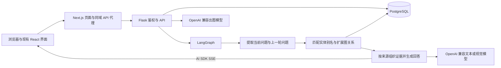

# iTip 架构

`frontend/` 使用 Next.js 15、React 19、Tailwind 和 AI SDK `useChat`。服务端页面从 Flask 获取登录状态和会话数据。浏览器发出同域 `/api/*` 请求，Next.js 转发 Cookie、状态码和流式响应。`backend/` 中的 Flask 负责账号、PostgreSQL 访问和模型调用。

## 页面与偏好

| 路由 | 用途 |
|---|---|
| `/`、`/login`、`/register` | 首页、邮件登录与注册 |
| `/chat?c=<id>` | 有权限的对话、历史、快捷提问、图片上传与参考图生成 |
| `/settings` | 页面风格、界面外观和账号安全。应用内也可以从对话页打开设置 |

页面风格与外观偏好由 `frontend/lib/appearance.ts` 统一保存在当前浏览器的 `localStorage`。`frontend/lib/visual-styles.ts` 定义四套风格的默认明暗、配色、侧栏位置与图像。登录和对话读取同一份偏好，手动指定的外观设置优先于风格默认值。修改密码沿用同域 API 和 Flask 会话校验。

LangGraph 的三个节点依次准备检索问题、检索知识图谱并生成流式回答。检索用简繁别名定位实体，在来源支撑的关系里扩展一跳，再按直接匹配和相关实体对证据排序。回答末尾附上检索到的来源链接。这一版本以关系图和文本匹配做本地图谱检索，资料规模小，可通过结构化导入扩充。

## 数据模型

- `users` 保存邮箱和 bcrypt 密码哈希。
- `chat_conversations` 保存所属用户、标题、置顶状态、时间戳和 AI SDK 消息 JSON。
- `rate_limits` 保存 HMAC 后的限速键及过期时间，多个运行实例共享计数。
- `kb_sources`、`kb_entities`、`kb_terms`、`kb_source_entities`、`kb_edges` 保存书法资料、实体、别名、出处关联和带出处的关系。知识库查询独立于用户会话。
- 本地和生产均使用 PostgreSQL，由 [`backend/schema.sql`](../backend/schema.sql) 初始化。后端通过 psycopg 执行参数化 SQL。

## 认证与会话

登录后，Flask 使用 `AUTH_SECRET` 签发有效期七天的 JWT，放在 HttpOnly、SameSite=Lax Cookie 中。Vercel 生产环境启用 Secure。Flask 会验证签名、有效期和账号是否仍存在。查询、更新和删除会话均校验所属用户。Next.js 服务端转发受保护的请求时附上共享的 `BACKEND_PROXY_SECRET`，Flask 对其进行校验。注册、登录、改密和对话等操作受数据库限速保护。

对话消息、附图及检索所得资料摘要会进入配置的模型服务，出图服务收到出图提示词。对话自动保存到 PostgreSQL，附图跟随消息存储。消息 JSON 未做应用层加密。服务商的留存政策及生成图片 URL 的有效期由服务商决定。数据库连接串、模型密钥和代理密钥不提交至 Git。

## 接口

| 方法 | 路径 | 用途 |
|---|---|---|
| GET | `/api/health` | 检查数据库及导入来源数量 |
| POST | `/api/auth/register`、`/api/auth/login`、`/api/auth/logout` | 注册、登录、退出 |
| GET | `/api/auth/me` | 当前登录用户 |
| PUT | `/api/auth/password` | 修改密码 |
| GET / POST | `/api/chat/conversations` | 列表与新建 |
| GET / PATCH / DELETE | `/api/chat/conversations/[id]` | 读取、保存、重命名、置顶或删除 |
| POST | `/api/chat` | LangGraph 书法对话，返回 AI SDK UI 消息 SSE |
| POST | `/api/images/generate` | 生成参考图 |

部署和扩充资料的操作见 [开发与部署指南](DEV.md)。
