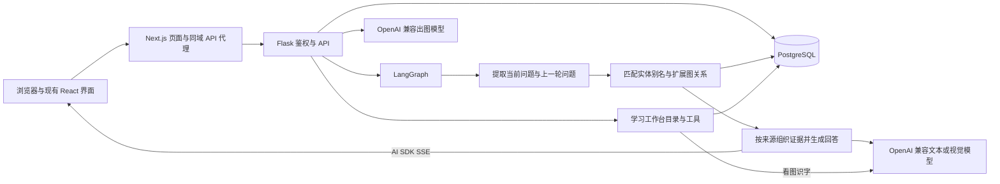

# iTip 架构

`frontend/` 使用 Next.js 15、React 19、Tailwind 和 AI SDK `useChat`。服务端页面从 Flask 获取登录状态和会话数据。浏览器发出同域 `/api/*` 请求，Next.js 保留检索和筛选参数，并转发 Cookie、状态码和流式响应。`backend/` 中的 Flask 负责账号、PostgreSQL 访问和模型调用。

## 页面与偏好

| 路由 | 用途 |
|---|---|
| `/`、`/login`、`/register` | 首页、邮箱或账号名登录与注册 |
| `/chat?c=<id>` | 有权限的对话与项目侧栏、标题搜索、模型菜单和输入框上方的四个工作台入口 |
| `/settings` | 页面风格、界面外观和账号安全。对话侧栏底部的账号菜单也可打开设置与帮助 |

页面风格与外观偏好由 `frontend/lib/appearance.ts` 保存在当前浏览器的 `localStorage`。登录和对话读取同一份偏好。所有风格的预设侧栏位置均为左侧，可在界面外观中手动调整。对话固定使用标准宽度。

LangGraph 的三个节点依次准备检索问题、检索知识图谱并生成流式回答。检索用简繁别名定位实体，在来源支撑的关系里扩展一跳，再按直接匹配和相关实体对证据排序。回答末尾附上检索到的来源链接。这一版本以关系图和文本匹配做本地图谱检索，资料规模小，可通过结构化导入扩充。

对话工作区在当前标签页里为各会话保留独立的 AI SDK 客户端。切换或新建对话时，原会话的流继续接收并在侧栏显示状态。用户消息在请求开始时保存，最终结果按会话顺序写回 PostgreSQL。刷新、关闭标签页或离开对话工作区会结束尚未完成的流。

学习工作台复用原生 `dialog` 的焦点管理。目录和日历通过同域 API 读写，拼图和排版在浏览器 Canvas 绘制并导出。看图识字把一张图片交给部署配置的默认视觉模型，并返回可编辑的文本。

系统提示词位于 `backend/agent.py`，明确书法教学范围、附图观察、来源引用、缺失信息和无法执行操作时的回答方式。知识库暂时不可用时，模型仍可给出带说明的通用练习建议。应用分开记录检索耗时和模型首段正文耗时。历史引用链接保留在对话中，提交模型时省去应用自动附加的链接清单。

## 数据模型

- `users` 保存邮箱、唯一账号名和 bcrypt 密码哈希。新用户可以用邮箱或账号名注册，已有用户可以验证当前密码后绑定账号名。两种身份登录同一账号时共享用户 ID 与对话。
- `chat_projects` 保存用户项目。`chat_conversations` 保存所属用户、项目、标题、置顶状态、时间戳和 AI SDK 消息 JSON。复合外键约束项目与对话属于同一用户。移入项目的对话在项目内排序，删除项目会清空归属并保留对话。
- `rate_limits` 保存 HMAC 后的限速键及过期时间，多个运行实例共享计数。
- `kb_sources`、`kb_entities`、`kb_terms`、`kb_source_entities`、`kb_edges` 保存书法资料、实体、别名、出处关联和带出处的关系。知识库查询独立于用户会话。
- 本地和生产均使用 PostgreSQL，由 [`backend/schema.sql`](../backend/schema.sql) 初始化。后端通过 psycopg 执行参数化 SQL。
- `study_*` 表保存目录、字形、收藏和练习计划。表字段、访问边界和导入顺序见[数据库设计](database.md)。

## 认证与会话

登录后，Flask 使用 `AUTH_SECRET` 签发有效期七天的 JWT，放在 HttpOnly、SameSite=Lax Cookie 中。Vercel 生产环境启用 Secure。Flask 会验证签名、有效期和账号是否仍存在。查询、更新和删除会话均校验所属用户。Next.js 服务端转发受保护的请求时附上共享的 `BACKEND_PROXY_SECRET`，Flask 对其进行校验。注册、登录、改密和对话等操作受数据库限速保护。

对话消息、附图及检索所得资料摘要会进入配置的模型服务，出图服务收到出图提示词。对话自动保存到 PostgreSQL，附图跟随消息存储。参考图结果使用 `data-calligraphy-image` 消息部分保存并在工作台预览，不进入后续聊天模型输入。消息 JSON 未做应用层加密。服务商的留存政策及生成图片 URL 的有效期由服务商决定。数据库连接串、模型密钥和代理密钥不提交至 Git。

发送键旁的模型菜单显示部署环境配置的默认模型。厂商预设来自 `frontend/lib/model-presets.ts`。自定义模型配置与选中项按账号 ID 保存到浏览器 `localStorage`。API Key 保存在当前标签页的 `sessionStorage`，随连通测试或对话请求提交，退出时清除当前标签页的密钥。Flask 访问公网 HTTPS 服务时固定到已验证的公网 IPv4 地址，保留域名用于 TLS 验证，禁止跟随重定向。

## 接口

| 方法 | 路径 | 用途 |
|---|---|---|
| GET | `/api/health` | 检查数据库及导入来源数量 |
| POST | `/api/auth/register`、`/api/auth/login`、`/api/auth/logout` | 注册、登录、退出 |
| GET | `/api/auth/me` | 当前登录用户 |
| PUT | `/api/auth/password` | 修改密码 |
| PUT | `/api/auth/username` | 验证当前密码并绑定或修改账号名 |
| GET / POST | `/api/chat/conversations` | 获取工作区列表或新建对话，可指定 `projectId` |
| GET / PATCH / DELETE | `/api/chat/conversations/[id]` | 读取、保存、重命名、置顶、移动项目或删除 |
| POST | `/api/chat/projects` | 新建项目 |
| DELETE | `/api/chat/projects/[id]` | 删除项目，对话归回历史列表 |
| POST | `/api/chat` | LangGraph 书法对话，返回 AI SDK UI 消息 SSE |
| POST | `/api/models/test` | 测试自定义服务的流式对话 |
| POST | `/api/images/generate` | 生成参考图 |
| GET | `/api/study/dictionary/<kind>`、`/api/study/glyphs` | 查询字词和对应馆藏字形 |
| GET | `/api/study/people`、`/api/study/works`、`/api/study/poems` | 检索书家、作品和诗词 |
| GET | `/api/study/favorites`、`/api/study/calendar?month=YYYY-MM` | 获取当前账号数据 |
| PUT / DELETE | `/api/study/favorites/<kind>/<id>`、`/api/study/calendar/<date>` | 增删收藏或写入、移除指定日期的计划 |
| POST | `/api/study/text/convert`、`/api/study/text/count`、`/api/study/ocr` | 繁简转换、字数统计、看图识字 |

## 图像与署名

| 文件 | 用途与来源 |
| --- | --- |
| `frontend/public/style-art/mi-fu.jpg` | 北宋米芾《吴江舟中诗》局部，大都会艺术博物馆，1984.174，公共领域。用于展卷风格、作品卡片和书法字典裁切。 [藏品页](https://www.metmuseum.org/art/collection/search/39919) |
| `frontend/public/style-art/yan-stele.jpg` | 颜真卿《颜氏家庙碑》二十世纪拓片局部，大都会艺术博物馆，1977.375.14a–d，公共领域。用于碑拓风格和作品卡片。 [藏品页](https://www.metmuseum.org/art/collection/search/64029) |
| `frontend/public/style-art/jade-desk.jpg` | 为 iTip 生成的原创青瓷习字案静物图，用于日课风格。 |

站点图标由 Next.js App Router 读取，PWA 图标见 [manifest](../frontend/public/manifest.json)。新增馆藏图片时核实许可，记录作者、题名、藏馆、图像是否为局部及原始链接。

部署和扩充资料的操作见 [开发与部署指南](dev.md)。
